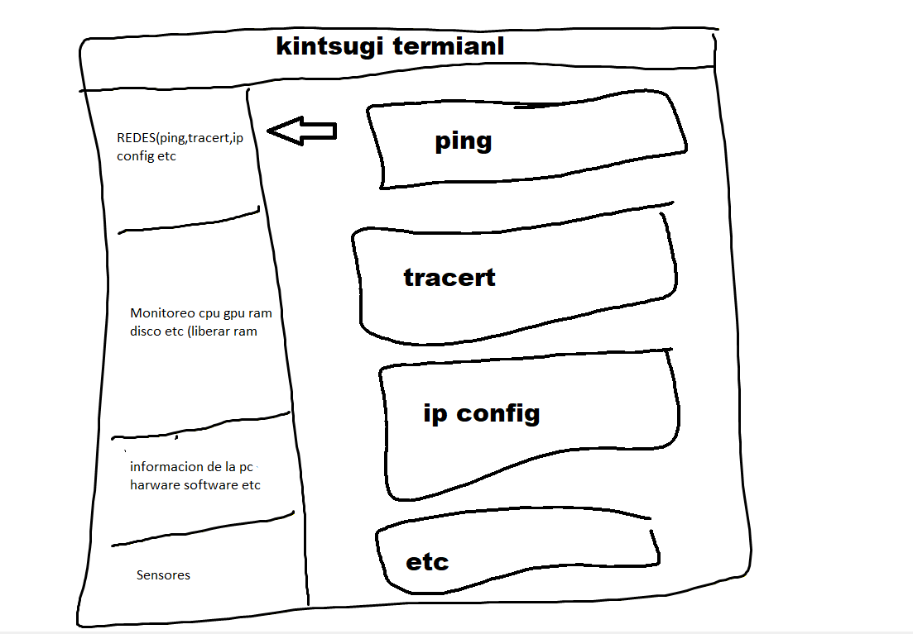
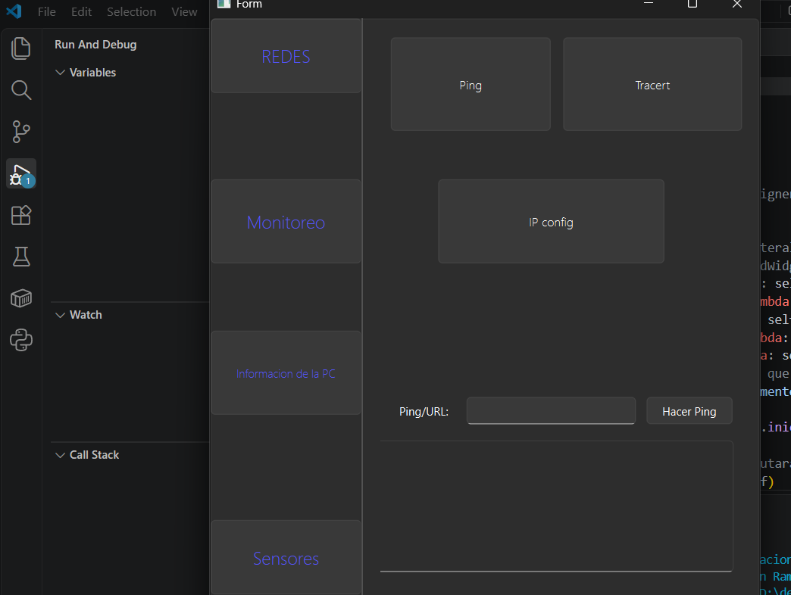

Diseño conceptual de la interfaz: Boceto inicial en el que se estructuró la distribución de la herramienta.
La idea principal es un panel lateral de navegación dividido por categorías lógicas (Redes, Monitoreo, Información de la PC y Sensores) 
que despliega las funciones principales de forma accesible al usuario en la pantalla principal.

Interfaz real y el nacimiento del "MVP": Logré armar la interfaz en modo oscuro y los botones para simular todo el menú de opciones. 
Sin embargo, la cruda realidad del desarrollo de software golpeó rápido: al final, solo el botón de Ping quedó completamente funcional. 
Los demás botones quedaron de adorno xd (fue mas tiempo de lo que crei xd)

Conclusión: Por qué decidí descartar este proyecto
Al final del día, entendí que no se puede nadar contra la corriente.
Intentar encapsular cada comando nativo de la consola de Windows, el monitoreo del hardware y los sensores en una sola interfaz gráfica hecha por una sola persona 
requiere un esfuerzo enorme que no vale la pena reinventar.

La consola de comandos ya hace su trabajo perfectamente y existen herramientas masivas dedicadas a esto. 
El proyecto cumplió su ciclo como un gran experimento de diseño de interfaz y lógica básica (¡el Ping sí funciona!), pero decidí dejarlo archivado para enfocar mi energía en proyectos más viables. 
Queda aquí como registro de lo que pasa cuando el diseño inicial es más rápido que el tiempo para programarlo.
